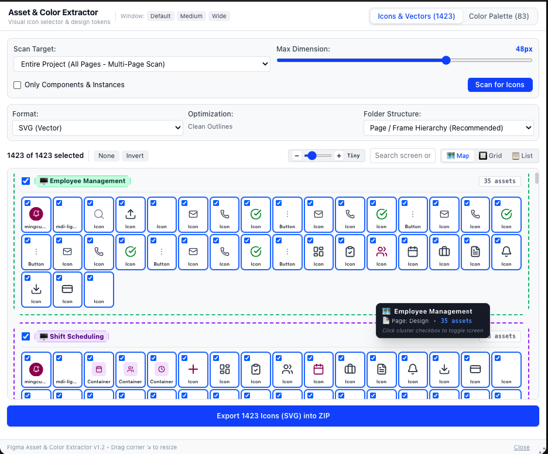
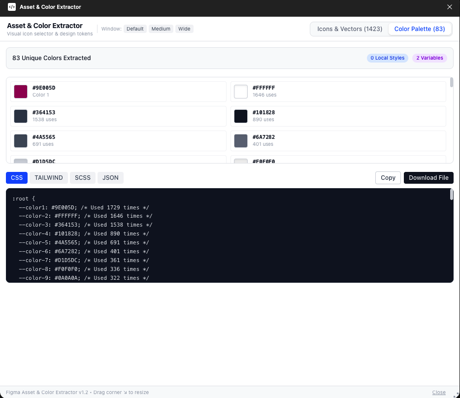

# Asset & Color Extractor — Figma Plugin

> A production-grade Figma plugin that batch-detects & extracts all icons across your frames/pages into folderized ZIP archives (SVG, PNG, PDF) with **live visual thumbnail previews**, **free window resizing**, **micro density zoom**, and extracts project colors into **design tokens** (CSS Variables, Tailwind Config, SCSS, and W3C JSON Tokens).

---

<p align="center">
  
</p>

<p align="center">
  
</p>

---

## ✨ Features

- 🎯 **Smart Icon Auto-Detection**: Heuristically detects icons across selections, current pages, or multi-page documents by aspect ratio, dimension filters, vector-only layer checks, and component tags.
- 🖼️ **Visual Thumbnail Grid Preview**:
  - Real-time SVG preview rendered inside each card.
  - One-click select/deselect directly by clicking any card.
  - Hover `🔍` button to zoom in and locate any icon on the Figma canvas.
- 🔍 **6-Level Zoom & Density Control (Up to 4x Smaller)**:
  - **Micro (4x Smaller)**: Ultra-compact $38\text{px}$ cells fitting **15–25 icons per row** ($200\text{--}400+$ icons visible on a single screen without scrolling!).
  - **Tiny (3x Smaller)**: $48\text{px}$ compact grid with small labels.
  - **XS (2x Smaller)**: $62\text{px}$ balanced grid.
  - **Small (Standard)**: $78\text{px}$ standard preview.
  - **Medium**: $98\text{px}$ preview.
  - **Large**: $124\text{px}$ detailed view.
  - Step buttons (`−` / `+`) and continuous density slider.
- 📐 **Interactive Drag-to-Resize Window**:
  - Drag the bottom-right corner (`↘`) to stretch window width & height freely.
  - One-click header presets: **Default** ($640\times700$), **Medium** ($840\times800$), and **Wide** ($1080\times880$).
- 📦 **Smart Folderization & Zero-Loss ZIP Packaging**:
  - **Slash Naming**: Turns Figma conventions like `Actions/Delete` into nested folders: `icons/Actions/Delete.svg`.
  - **Parent Frame Fallback**: Automatically organizes generic names (`Icon`, `Container`, `Button`) into parent screen folders.
  - **Collision Prevention**: Automatically prevents duplicate overwrites (`Icon.svg`, `Icon-1.svg`, `Icon-2.svg`) ensuring **100% of detected assets are exported**.
- 🎨 **Project Color Palette & Design Tokens Extractor**:
  - Extracts Figma Local Paint Styles & Variables.
  - Scans raw node fills & strokes, computing exact usage frequency counts.
  - Exports directly as **CSS Custom Properties (`:root`)**, **Tailwind CSS (`tailwind.config.js`)**, **SCSS**, or **W3C Design Tokens JSON**.

---

## 🚀 Installation & Setup

### 1. Build the Plugin
```bash
cd /Users/ideatedlab/Projects/figma-asset-color-extractor
npm install
npm run build
```
This produces the self-contained production bundle:
- `dist/code.js` (Figma sandbox main thread)
- `dist/index.html` (Plugin UI iframe with bundled Tailwind & React)

### 2. Import into Figma Desktop App (One-Time Setup)
1. Open the **Figma Desktop App**.
2. Open any design file.
3. In the top menu bar, select:
   **Plugins** ➔ **Development** ➔ **Import plugin from manifest...**
4. Choose the `manifest.json` file:
   `/Users/ideatedlab/Projects/figma-asset-color-extractor/manifest.json`
5. The plugin is now permanently added to your development plugins!

---

## 📖 User Manual (Step-by-Step Usage Guide)

### Running the Plugin
Inside any design file:
- **Right-Click** on the canvas ➔ **Plugins** ➔ **Development** ➔ **Asset & Color Extractor**.
- OR press **`Cmd + /`**, type `Asset & Color Extractor`, and hit **Enter**.

---

### Tab 1: Icons & Vectors Workflow

1. **Configure Scan Target**:
   - **Current Page**: Scans the active canvas page.
   - **Current Selection**: Scans only highlighted frames or components.
   - **Entire Project**: Scans across all pages in the document.
2. **Set Max Dimension**:
   - Default is `48px`. Adjust the slider if you want to include larger graphics up to `64px`.
3. **Click "Scan for Icons"**:
   - All vector icons are automatically detected and streamed into the visual gallery.
4. **Customize View & Selection**:
   - **Zoom Density**: Click `−` to shrink cards down to **Micro** mode (fits hundreds of icons per screen).
   - **Search**: Type in the search box to filter icons by name or parent frame.
   - **Selection**: Click any card to toggle. Use **All**, **None**, or **Invert** buttons for bulk selection.
   - **Locate**: Hover over any card and click the `🔍` button to highlight the icon directly on the canvas.
5. **Set Export Options**:
   - **Format**: Select `SVG`, `PNG` (1x, 2x, 3x), or `PDF`.
   - **Folder Structure**: Select `Slash Naming`, `Page/Frame Hierarchy`, or `Flat`.
6. **Click "Export Icons into ZIP"**:
   - Generates and downloads a clean, folderized `.zip` archive containing all selected icons without any file collision.

---

### Tab 2: Color Palette & Tokens Workflow

1. Switch to the **Color Palette** tab at the top of the plugin window.
2. View all extracted colors:
   - Unique HEX & RGB values.
   - Figma Local Style & Variable names.
   - Exact usage counts (how many times each color is used across the file).
3. **Export Design Tokens**:
   - Choose your framework format: **CSS**, **Tailwind**, **SCSS**, or **JSON**.
   - Click **Copy** to copy the token snippet to your clipboard.
   - Click **Download File** to save `design-tokens.css`, `design-tokens.js`, or `design-tokens.json` directly into your codebase.

---

## ❓ Troubleshooting & FAQs

### Q1: The plugin window doesn't open when clicking in Figma?
- **Ensure you are in Design Mode**: If you are in Figma **Dev Mode** (green badge/header), press **`Shift + D`** to toggle back to standard Design Mode. Modal UI plugins cannot run in Dev Mode.
- **Ensure you have Edit Access**: If the file has a yellow `View only` banner, duplicate the file to your Drafts: **File** ➔ **Duplicate to your drafts**. Development plugins require edit permissions to inspect canvas nodes.

### Q2: How do I resize the plugin window?
- Drag the **bottom-right corner (`↘`)** to resize the window freely.
- Or click the **Default**, **Medium**, or **Wide** preset buttons in the plugin header.

---

## 🛠️ Development & Customization

To watch for file changes during development:
```bash
npm run build
```
Every time you run `npm run build`, simply close and re-open the plugin in Figma to load the updated code.
